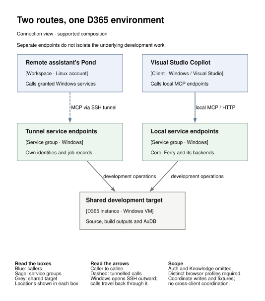

# Working with pondNT

An assistant can help write an X++ change, build it on the development VM,
walk through the D365 form and check what reached the database. pondNT
provides the tools for that loop. You can use them beside Visual Studio on
one machine, or reach the Windows environment from a Linux Pond.

D365 and its build tools still run on Windows. The agent acts with the
configured Windows and D365 accounts' permissions; browser and warehouse
steps can change business data. Use a development or test environment and
agree on the records the assistant may touch.

## Choose where to work

| Your situation | Start with | Why |
|---|---|---|
| Copilot and D365 on one Azure development VM | [Local development](#one-development-vm) | Keep the tools beside the code; no Linux host or tunnel required. |
| Your assistant's workspace is on Linux | [Remote development](#work-from-linux-run-d365-on-windows) | Keep project records and Linux tools there, while Windows performs D365 work. |
| Several environments keep rediscovering the same things | [Shared Knowledge](#one-notebook-across-environments) | Keep reusable lessons outside any disposable VM. |
| Copilot and another assistant work on one environment | [Two routes](#local-copilot-and-a-remote-assistant) | Use both clients without moving the development environment between them. |

These layouts can be combined. The [installation guide](INSTALL.md) owns
the setup commands; this page explains what to choose and what it enables.

## What makes the tools useful for D365

A shell can run a build. The D365 service gives the assistant a build job
and compiler diagnostics it can inspect as rows. A source index can find an
X++ element or label without a new crawl through the package directory.
The browser and warehouse tools extend that same approach into the
application: the agent can act, inspect the result and decide what to do next.

### Browser forms the agent can read

With [d365web](D365WEB.md), the assistant opens a menu item in an explicit
company, reads named fields and controls, selects grid rows, handles lookups
and presses actions. It can inspect a validation message or an unexpected
dialog instead of assuming that a click worked.

For example, ask:

> Open the purchase-order list in USMF. Read its current form and controls.
> Do not create, edit or post anything.

On a Contoso environment with that company, the underlying calls are:

```text
web_open(menu_item="PurchTableListPage", company="usmf")
web_state(full=true)
```

These are tool-call sketches, not a shell script. Discover the server's
actual schema before calling it. If the first call returns `running`,
collect it with `web_wait` before asking for state. Check the company and
form in the answer. Elsewhere, substitute a company that actually exists.

Generic browser automation can click a page too. The useful difference is
the D365 vocabulary: menu items, active forms, field names, lookups, grids
and application messages. Coordinates remain a fallback. Once a sequence
is understood, `web_run_scenario` can run steps with explicit expectations.

A visible browser (`headless: false`) is useful to watch a step. It keeps
working when its window is covered or nobody looks at the machine; headless
remains the default for unattended work.

A quiet page is not proof of a successful action. `pressed` means the click
was dispatched; the returned state must show the intended transition.
Verify a saved business effect separately when it matters.

### Warehouse flows the agent can follow

With [d365whsapp](D365WHSAPP.md), the assistant logs a test worker in,
reads the current page, submits editable fields and a button, and reads
the next page. It can explore a flow interactively, then express a known
path as a scenario with expected labels, fields and messages.

This is useful when the question is more specific than “did the code compile?”:
does the receiving flow request the batch at the right point, reject a bad
value, retain its lock on retry, and create the expected work?

Two configured backends expose the same `whs_*` tools:

| Backend | What you exercise | What a pass does not establish |
|---|---|---|
| `form` | The warehouse simulator inside the D365 web client, using a signed-in Edge profile | Mobile protocol or physical-device behaviour |
| `app` | The warehouse mobile-app service protocol | Microsoft's mobile app UI, scanner or physical device |

The service does not silently switch between them. Establish the configured
mode before testing, and preserve the result's `not_checked` items.
App mode has environment-specific authentication prerequisites; a working
browser sign-in does not satisfy them.

Use a dedicated worker and disposable fixtures. Inspect `whs_screen`
before choosing the next `whs_submit`; use the control names returned by
that environment. A long scenario is collected with `whs_wait`. A pending
single form-mode step is collected with `whs_screen` for its worker.
[The waiting rules](D365WHSAPP.md#waiting-for-a-result) keep an uncertain
receipt from becoming an accidental second receipt.

## One development VM

You already work in Visual Studio on an Azure-hosted D365 development
machine. Copilot can edit code, but it also needs to search the application,
build, read errors and check the behaviour it changed.

Install pondNT on that machine. The recommended local layout gives Copilot
three MCP entries: **core, Knowledge and Ferry**. Core provides files,
commands and jobs; Knowledge keeps reusable notes within reach. Ferry
discovers and calls the selected specialist services, including D365,
Sourcecache and the optional browser and warehouse tools.

This keeps the initial tool list small without removing the specialist
operations. Tool schemas consume model input when the client sends them;
discovering them when needed can reduce that overhead. Actual savings
depend on the client and task. Ferry forwards calls; each backend still
owns its process, permissions and results.

Start with the [installer's preview](INSTALL.md#the-short-way-setupps1),
using `-Gateway all` and the complete service selection you intend to run.
Configure browser and warehouse backends explicitly; the gateway flag does
not enable them by itself. After installation, bootstrap core, inspect the
available services and try the read-only browser check above.

The standard installer creates scheduled tasks. Where a host deliberately
cannot use them, an operator-maintained manual launcher can start the same
servers; it must own their startup and shutdown. That is a separate operating
arrangement, not another built-in installer mode.

**Evidence:** this local arrangement is used on Azure development machines,
including build, file-edit and form-mode receiving work. It does not establish
every customer extension or every mobile-protocol route.

## Work from Linux, run D365 on Windows

Your assistant already has a Linux workspace: repositories, project notes
and command-line tools. You want it to work on D365 without moving that
workspace into the development VM.

Keep the workspace in a [Linux Pond](https://github.com/the-boring-crocodile/boring-pond/blob/main/docs/getting-started.md).
Run pondNT on a Windows D365 development VM and connect the selected
services through the [Pond tunnel](DEVBOX_TUNNEL.md). The Windows machine
opens an SSH connection outward. The Linux Pond calls the forwarded
endpoints; compilation, database access and browser execution happen on
Windows. The service ports stay on loopback rather than becoming public
internet listeners.

Microsoft provides a **downloadable development VHD** (virtual hard disk)
for a local one-box environment. Follow Microsoft's
[environment deployment](https://learn.microsoft.com/en-us/dynamics365/fin-ops-core/dev-itpro/dev-tools/access-instances)
and [VHD first-use](https://learn.microsoft.com/en-us/dynamics365/fin-ops-core/dev-itpro/dev-tools/vhd-setup)
instructions before adding pondNT. The VM needs its own provisioning,
sign-in and suitable host; pondNT neither supplies nor licenses D365.

The Linux host need not be the VM host. The same service route can reach a
Windows VM on another machine or an Azure development box. This is remote
use of Windows tools, not a port of D365 to Linux or a promise that any
hypervisor is supported.

Provision the tunnel's service identities and caller grants, start it from
Windows, then verify an authenticated read from the Pond. A listening port
alone is not the check. The tunnel guide owns setup, reconnection and teardown.

**Evidence:** Linux-Pond-to-Windows development and test work has been
exercised through these services. Visual Studio designers, debugging and
IDE-owned project or element registration remain Windows/IDE work; the
tunnel does not replace them.

## One notebook across environments

A developer solves a build quirk on one VM. Another assistant meets it a
week later on another. A local chat or a notebook stored only on the first
VM is easy to lose when that environment is rebuilt.

Run [Knowledge](https://github.com/the-boring-crocodile/boring-services/blob/main/knowledge/README.md)
as an independent service and connect the intended clients over authenticated
HTTPS. It can live offsite, independently of the Windows machines, and
serve several developers or Ponds. Each authorised caller can search the
same notebook; writers can add or revise entries with attribution and history.

Keep it direct in the client where practical, so looking up a lesson does
not first require specialist-tool discovery. Configure its endpoint and
access through the service's
[configuration guide](https://github.com/the-boring-crocodile/boring-services/blob/main/docs/CONFIGURATION.md)
and the client's MCP settings. The local pondNT installer does not provision
an offsite server or automatically merge its notebook with a local one.
Confirm sign-in and a read from each intended client.

Store a small lesson with its version, context and evidence: what failed,
what fixed it, and where that was checked. Sometimes the agent needs the
plain nudge: “Try the knowledge base first.”

A notebook is a shared trust boundary. Readers can read its entries; every
writer may revise any entry, with history retained. Tags are not access
controls. Use separate instances for customer-confidential material and
general lessons; they are not automatically synchronised. Credentials and
business records do not belong in the shared notebook.

**Evidence:** Knowledge supports both Pond callers and direct clients.
The shared-notebook design does not prove that every client version's OAuth
sign-in and refresh works; check the clients you intend to use. Project
status still belongs in the repository, and the notebook still needs backup.

## Local Copilot and a remote assistant

You want Copilot beside Visual Studio while another assistant investigates
from a Linux Pond. Both need access to the same D365 development environment,
without replacing each other's connection.

Keep the local core/Knowledge/Ferry setup. Add the tunnel route for the
remote Pond. The supplied tunnel helper starts **separate service endpoints**
with their own identities, ports and process records alongside the local
installation. It does not forward the existing local Ferry automatically.
Both routes can act on the same underlying files and D365 instance.

<picture>
  <source media="(prefers-color-scheme: dark)" srcset="working-routes-dark.svg">
  
</picture>

That makes a useful division possible: one assistant owns the code change
and build, while the other reviews the source, checks a documented result
or prepares a test. The tools have the same responsibilities on each route;
the process-local job records and browser sessions need not be the same.

Give separate browser service instances their own profile directories and
debugging ports. Give parallel warehouse runs separate workers and fixtures.
One d365web instance has one active browser step; a `busy` response protects
that instance, not all clients and services touching the environment.
Separate endpoints do not isolate AxDB, source files or build outputs.

Agree who owns edits, builds, syncs and each test fixture before overlapping
work. Record a handoff before the other assistant takes control. Simultaneous
connectivity is useful; two assistants pressing the same workflow is not a
coordination mechanism.

**Evidence:** local and tunnel routes are implemented and have their own
operational checks. This is a supported composition of those routes, not a
claim of unrestricted concurrent-write acceptance on every Azure environment.

## A development loop worth trying

Choose a small warehouse validation change on a test environment. Define
one allowed receipt and one rejected receipt, with disposable records and
the expected database effects, before asking the assistant to act.

| Step | Tool owner | What to check |
|---|---|---|
| Understand the existing behaviour | Sourcecache and D365 `xref` | Relevant code, labels and callers; the index matches the source version under investigation. |
| Make the change | Core file tools and the IDE | Review the diff; keep project/element registration with Visual Studio. |
| Compile and sync if needed | D365 service | Collect the job and inspect diagnostics; a started build is not a passed build. |
| Prepare and inspect the UI | d365web | Correct company, form and fixture; verify each intended transition. |
| Exercise receiving | d365whsapp | Correct backend, worker and next screen; stop at an unexpected result. |
| Verify the effect | D365 read-only SQL queries | Expected quantity, work and exception records; no unintended receipt or duplicate. |
| Leave the result behind | Project records and Knowledge | Keep the test evidence with the change; share only the reusable, appropriately scoped lesson. |

A successful receiving test establishes the receiving behaviour you checked.
It does not also prove put-away, later posting, device authentication or
business-event delivery. Name those as separate tests when they matter.

Start with [one local VM](INSTALL.md), or add the
[tunnel](DEVBOX_TUNNEL.md) to a working Windows environment. Make the first
read answer correctly, then give the assistant one small job whose result
you know how to verify.
